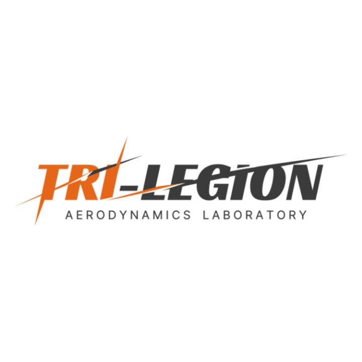
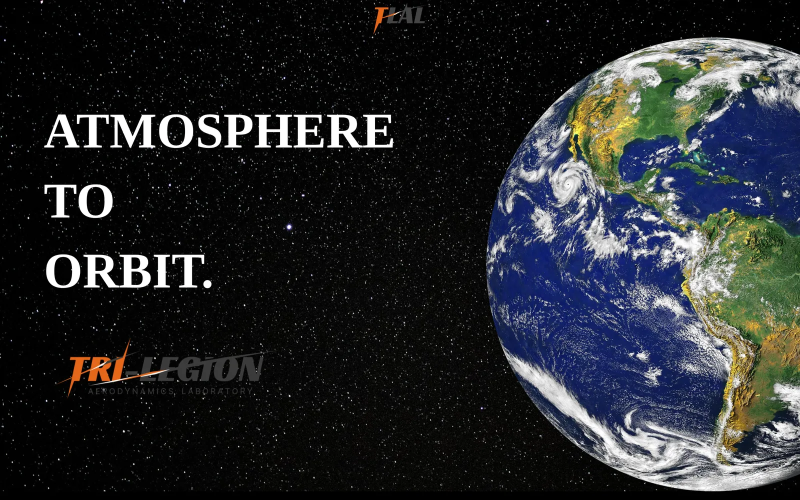

<div align="center">



# TRI-LEGION AEROLAB

**ATMOSPHERE TO ORBIT.** — TLAL(Tri-Legion Aerodynamics Lab) 공식 홈페이지


[**tlal.jiwon.site →**](https://tlal.jiwon.site)



</div>

## 소개

드론·항공우주 프로젝트 팀 TLAL의 소개 페이지입니다. 다음 발사 카운트다운, 팀의 미션, 구성원 소개, 공식 굿즈(티셔츠)를 한 페이지에 담았습니다. 팀의 첫 프로젝트는 [TLAL-Drone](https://github.com/jiwonsudo/TLAL-Drone)에서 볼 수 있습니다.

| 섹션 | 내용 |
|---|---|
| Hero | 지구와 우주 배경 위 "ATMOSPHERE TO ORBIT." |
| Our Next Launch 🚀 | 다음 발사까지 카운트다운 (발사 후에는 Mission Elapsed Time) |
| Our Mission | 팀 미션 소개 |
| Our Investigators | CEO · CTO · Intern 소개 |
| Upcoming Official Goods | 공식 TLAL 티셔츠 |

## 배포

32비트 라즈베리파이(arm32v7)에서 Nginx 컨테이너로 직접 호스팅합니다.

```bash
docker build -t tlal-homepage .
docker run -d -p 80:80 --name tlal tlal-homepage
```

로컬에서 확인할 때는 정적 서버면 충분합니다.

```bash
python3 -m http.server 8000
```
